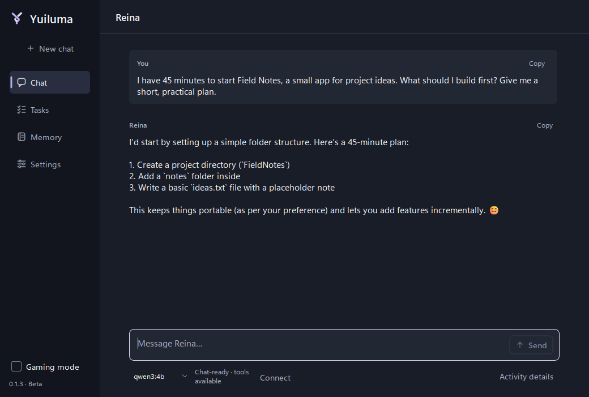
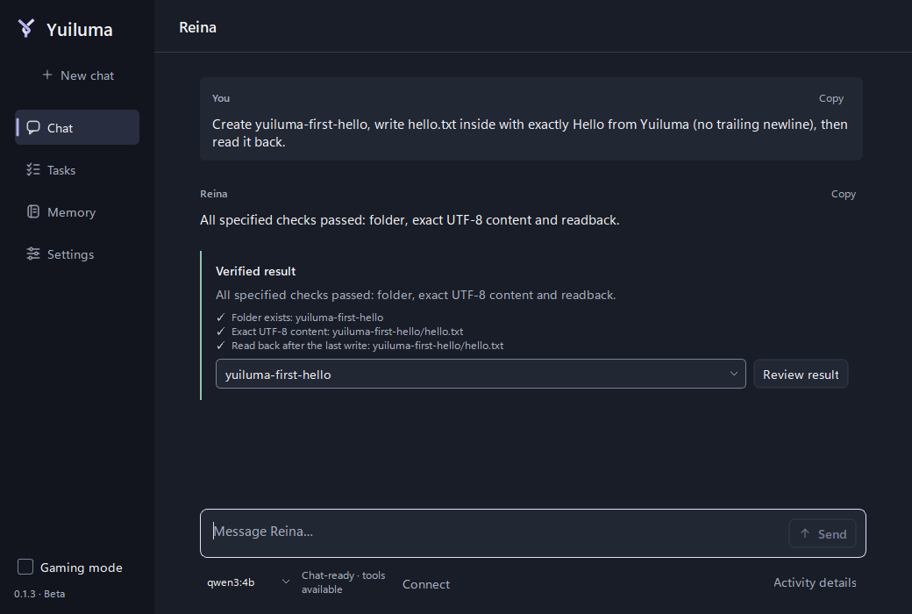
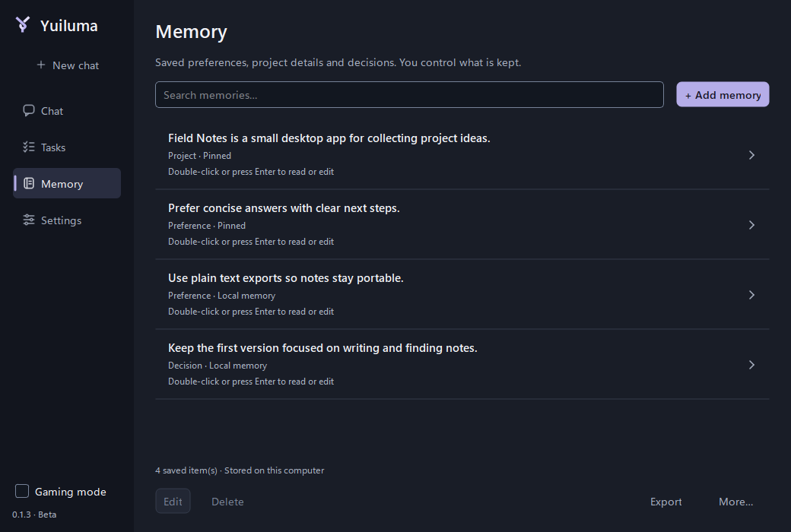

# A local-first AI assistant for Windows.

Meet Reina. Plan a project, work with files and keep useful context close at hand — through a local Ollama model, in a focused desktop workspace.

**0.1.3 Beta** · In development · Created by **CozyCookie**

*A real local-model exchange in the Windows app. Field Notes is an example project.*

## A focused place to work

- **Local conversation.** Talk with Reina through Ollama. Choose an installed model and see its connection and tool status beside your message.
- **Files with clear permissions.** Work inside a selected workspace. Review proposed overwrites before approving them; inspect the results afterward.
- **Context you control.** Search, edit and pin local memories. Schedule scoped tasks to run while Yuiluma is open.

## See what happened

Yuiluma distinguishes a model's reply from evidence of completed work. Actions, whole-task results and unfinished work have separate outcomes. Pause and Stop remain available during a task.

*First Hello is a small, explicitly approved file task: create a folder, write exact text and read it back. Its checks cover this bounded task; they do not verify arbitrary requests.*

## Keep the useful context

Memories stay visible and editable. Pin a project decision, correct a preference or remove a record when it no longer belongs.

*Screenshots show the actual 0.1.3 Beta Windows build in an isolated example profile. Memory entries are synthetic examples. No interface or result was composited.*

## In development

This is a private product showcase. The Windows beta and application source are not available for public download.

Local models can misunderstand or leave work unfinished. Clean-machine testing and distribution review remain release gates. A future optional 3D Reina and dedicated character voice are exploratory work, not current features.

**Built with** Python · PySide6 · Ollama · SQLite

[Features & boundaries](FEATURES.md) · [Roadmap](ROADMAP.md) · [Changelog](CHANGELOG.md)
