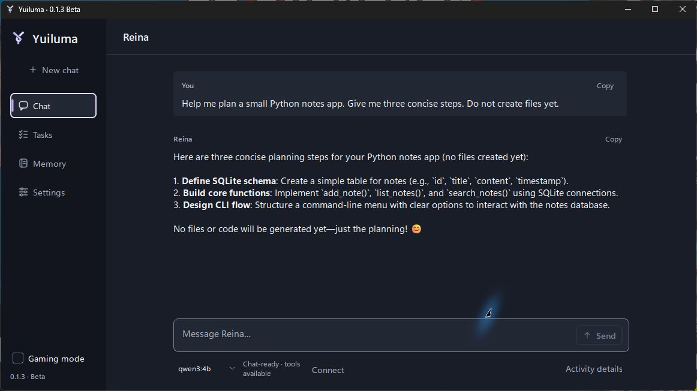
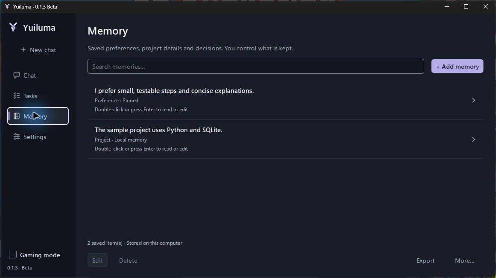
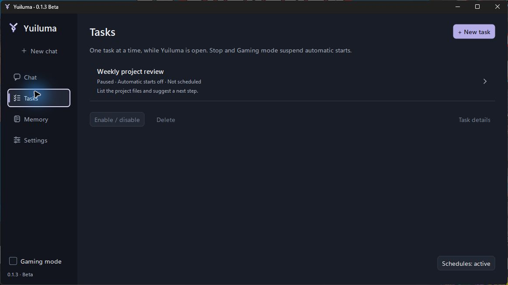
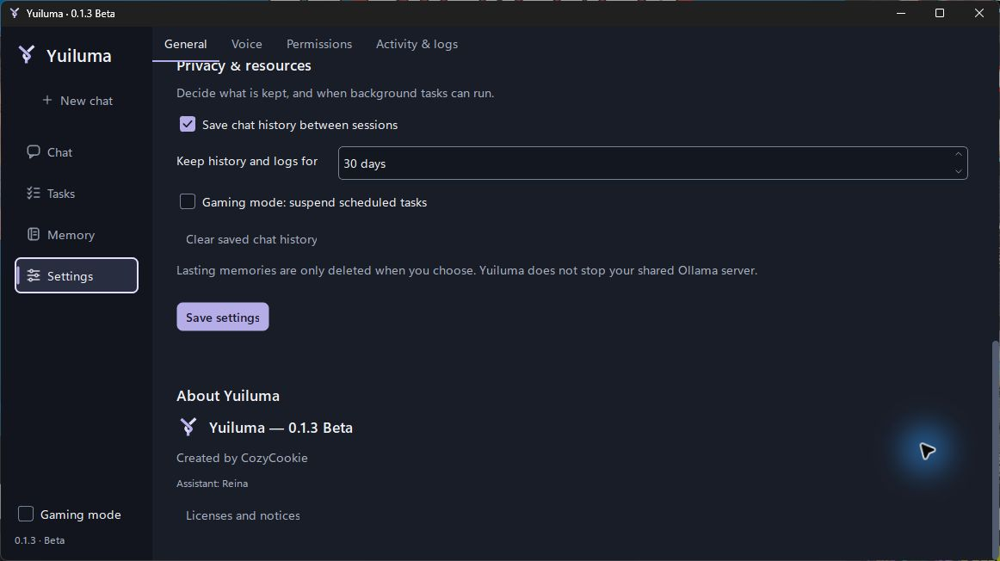

# Yuiluma

**A local-first Windows AI assistant, with Reina as its original assistant character.** Yuiluma combines local conversation, scoped file work, saved memories and scheduled tasks in a quiet, focused desktop interface. It uses a separately installed Ollama model and keeps permissions and execution evidence visible.

0.1.3 Beta · Private development · No public binary download

## Four focused spaces

| Space | Purpose |
| --- | --- |
| Chat | Talk with a local model, draft requests and inspect results. |
| Tasks | Manage bounded schedules and review their scope and outcomes. |
| Memory | Search, edit, pin, export and delete context you choose to keep. |
| Settings | Configure local AI, workspace permissions, privacy, motion and optional introduction replay. |

Starter prompts fill editable drafts. First Hello is optional; its sample file task requires a chosen folder and explicit approval. Individual action receipts are separate from whole-task verification. Local models can still omit work or give incorrect explanations.

## Control and limits

Sensitive actions require approval. Pause and Stop are available during work; closing the window cancels activity and cleans up. Completed changes remain. There is no silent cloud fallback or automatic model download. Approved web requests contact the selected website, and approved Python tests have the user's OS permissions.

The interface is English. Reply language and quality depend on the chosen model. Reina's future 3D Chat Avatar, Desktop Companion and character voice are planned separately and are **not included**.

This private showcase contains product information and sanitized application screenshots only. It offers no source code, binaries or public release. Dependency-distribution review, clean second-machine validation, signing, branding review and owner acceptance remain release gates. No general model or accessibility certification is claimed.

[Features](FEATURES.md) · [Roadmap](ROADMAP.md) · [Changes](CHANGELOG.md)

## About

Created by CozyCookie

